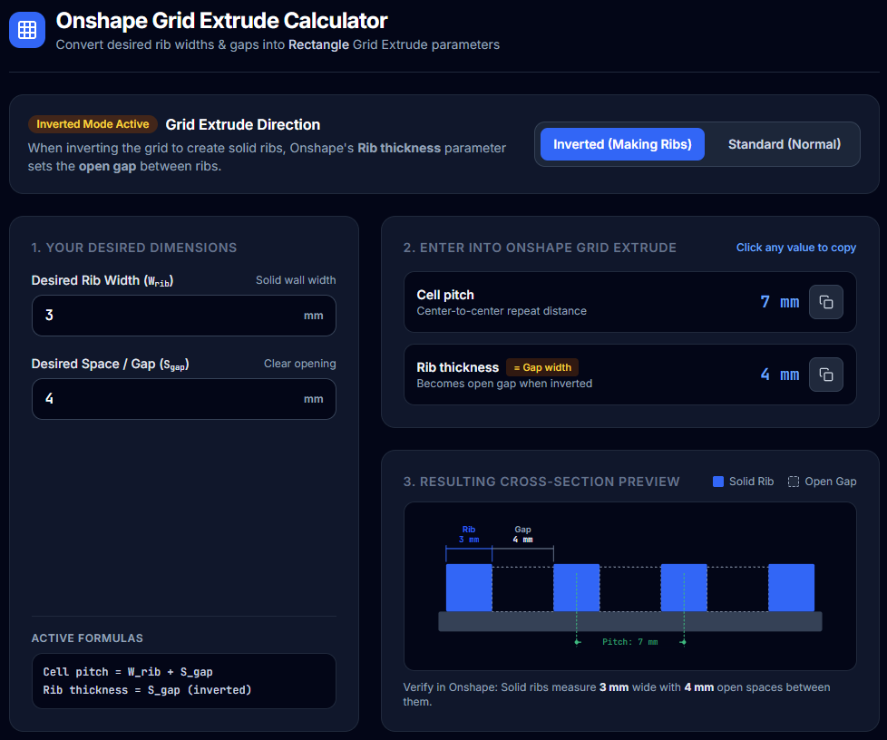

# Onshape Grid Extrude Calculator

A small browser-based calculator that converts desired rib widths and gaps into the parameters needed for Onshape's Rectangle Grid Extrude feature. It supports normal and inverted modes and provides a live cross-section preview.

Open `index.html` in a browser to use the calculator, or view it online here: [https://mattcuk.github.io/onshape-grid-extrude-calculator/](https://mattcuk.github.io/onshape-grid-extrude-calculator/)

